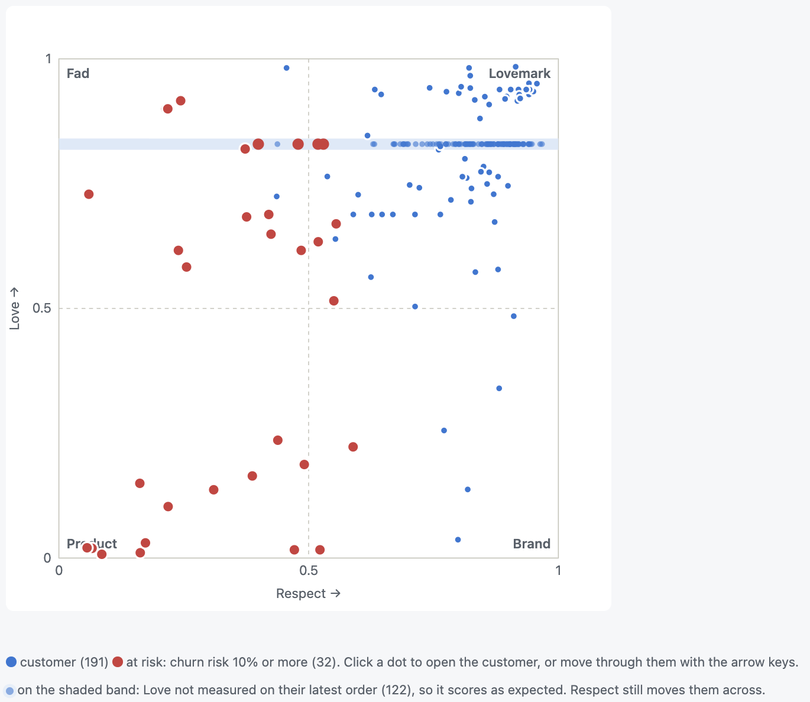
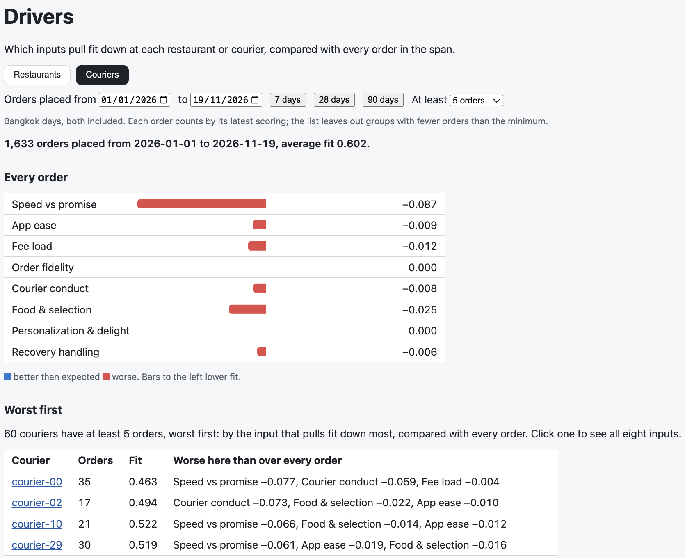

# Supplement: Customer Fit Intelligence

This supplement goes with the paper, `main.tex`. It gives every setting
the page limit leaves out and the full tables behind the paper's numbers.
Every number here is printed from a result file in `notebooks/results/`;
`SOURCES.md` says which notebook writes which file. Section and table
numbers below refer to the paper.

## 1. Reproducing the results

From the repository root, with Python 3.12:

```bash
python -m pip install -e "fitcore[dev,lab,train,paper]"
cd notebooks
python t110_recovery.py      # recovery and its baselines, 5 populations
python t111_ablation.py      # Table III's changes in loss
python t802_baselines.py     # Tables II and V, 20 populations
python t803_robustness.py    # Table IV
python t803_small_data.py    # Fig. 2
python t804_drivers.py       # Fig. 4
python t805_olist.py         # Section V-G (needs the Olist files in notebooks/data/olist/)
cd ..
python paper/figures.py      # redraws the paper's figures
```

Every notebook draws its data from fixed seeds, so a rerun writes the same
file. The one exception is the unconstrained network: its optimiser stops at
an iteration limit, so its AUC can differ between machines by up to 0.003.

## 2. The simulator

The simulator lives in `fitcore/src/fitcore/sim*.py`. Each population has
2,000 customers who order over 180 days from 1 January 2026.

**Hidden model.** The same connections and signs as CFI (Fig. 1). Each gap
passes through its own asymmetry and is divided by a typical gap:

| Input | $\kappa$ | Typical gap | Respect | Love |
| --- | --- | --- | --- | --- |
| $x_1$ speed (minutes) | 2.0 | 10 | 0.3 | |
| $x_2$ app ease (seconds) | 1.5 | 30 | | |
| $x_3$ fee load (share of basket) | 2.0 | 0.03 | | |
| $x_4$ order fidelity (share right) | 3.0 | 0.1 | 0.4 | |
| $x_5$ courier rating (stars) | 1.5 | 0.7 | 0.25 | |
| $x_6$ food rating (stars) | 2.0 | 0.7 | 0.3 | 0.4 |
| $x_7$ personalisation (hit rate) | 1.2 | 0.2 | | 0.3 |
| $x_8$ recovery (score) | 2.5 | 1.0 | | 0.35 |
| bias | | | 1.0 | 0.7 |

Convenience $= \sigma(2.0\,\text{Respect} + 0.25 z_1 + 0.3 z_2 + 0.4 z_3 - 1.0)$,
Trust $= \sigma(2.5\,\text{Respect} + 2.5\,\text{Love} - 2.7)$ and
Fit $= \sigma(5\,\text{Trust} + 3\,\text{Convenience} - 4.3)$, which averages
about 0.56 over simulated orders.

**Orders.** Each customer has usual levels for every measure (population
average, spread across customers, noise per order):

| Measure | Usual | Spread | Noise |
| --- | --- | --- | --- |
| $x_1$ delivery time, minutes | 32 | 6 | 4 |
| $x_2$ time to checkout, seconds | 90 | 20 | 15 |
| $x_3$ fee over basket | 0.12 | 0.03 | 0.01 |
| $x_4$ share of items right | 0.97 | 0.01 | 0.02 |
| $x_5$ courier rating | 4.5 | 0.25 | 0.3 |
| $x_6$ food rating | 4.3 | 0.3 | 0.3 |
| $x_7$ recommendation hit rate | 0.3 | 0.1 | 0.1 |
| $x_8$ recovery score | 4.0 | 0.4 | 0.3 |

The promised time is the customer's usual delivery time minus their usual
lateness (mean 2 minutes, spread 4, at least 10 minutes in all). The days
between a customer's orders are lognormal around a median of 7 (sigma 0.5),
and Fit speeds or slows the next order (pace 2: Fit 0.8 waits about 0.55
times as long as usual, Fit 0.2 about 1.8 times). Each customer's chance that
an order goes wrong is drawn from Beta(2, 18), 10% on average, and an
incident moves one input: late +20 minutes ($x_1$), wrong items $-0.15$
($x_4$), a rude courier $-2$ stars ($x_5$), cold food $-1.5$ stars ($x_6$),
poor support $-1.5$ ($x_8$).

**Expectations.** As in the paper's equations (1) and (2): weight 0.3 once
warmed up, prior weight 3, a 60-day half-life, and the population averages
above as priors (`fitcore/src/fitcore/expectations.py`).

**Outcomes.** After each order the customer stops for good with chance
$\sigma(-4 + 6(0.5 - \text{Fit}))$: 1.8% at Fit 0.5, 10% at 0.2. Otherwise
the next order comes after an exponential wait whose mean is the customer's
usual interval times $\exp(-2(\text{Fit} - 0.5))$, so outcomes also follow
each customer's own pace, which history carries and the gaps do not; the true
Fit alone is therefore a reference, not a strict ceiling. One order in
five gets a survey question, rotating through the NPS question and the four
state items. The NPS answer counts how many of ten cuts
($-0.6, -0.2, 0.1, 0.5, 0.9, 1.3, 1.9, 2.7, 3.5, 4.4$) lie below
$6\,\text{Fit}$ plus logistic noise; an item answer, 1 to 7, does the same
with slope 12 and cuts $3.7, 4.5, 5.2, 6.1, 7.0, 8.1$, so it follows its true
state with a correlation of about 0.6. Behaviours are one value per customer
from their average true states (slopes: favourites 10, promotion-free share
12, average rating 3.5, new restaurants 10, saved payment 20, checkout 2.5),
each correlating 0.45 to 0.7 with its state. Labels: reorder if another
order comes within 14 days, churn if none comes within 30.

**Events.** For the event-measured results, `fitcore/src/fitcore/sim_events.py`
writes each order as v1 events: 30% of orders without an incident are rated,
and every order with one is rated and gets a support case. There are 40
restaurants and 60 couriers; planting (the driver test) moves 80% of one kind
of incident to the planted restaurants or couriers.

## 3. Training CFI

`fitcore/src/fitcore/train.py`. Float64 throughout. Weights start at 0.5
(after softplus), biases at 0 and $\kappa$ at 1.5. The loss is the paper's
equation (5), with $10^{-4}$ times the squared sum of every weight and slope.
Full-batch L-BFGS with a strong-Wolfe line search runs in rounds of 20
iterations; training stops when the loss changes by at most $10^{-9}$
(relative) between rounds, or after 200 rounds. The gap scales $s_i$ are the
root mean square of each raw gap over the training orders.

Parameters: 15 path weights, 5 biases and $\kappa$ (21) carry the gaps to
Fit; the heads add 15 (two intercepts and two slopes for reorder and churn,
one slope and ten cuts for NPS) and the anchors 16 (four item slopes, and an
intercept and slope for each of six behaviours): 52 in all.

## 4. Comparators and evaluation

All in `notebooks/t802_baselines.py`, with helpers in
`fitcore/src/fitcore/baselines.py`. Each population is split 80/20 by
customer; every model is fitted on the training customers' orders with known
labels and judged on the held-out customers' orders.

- **Logistic regression:** standardised inputs, scikit-learn's
  `LogisticRegression` (default penalty). On surplus and shortfall, each gap
  becomes two columns, $\max(d, 0)$ and $\min(d, 0)$.
- **Gradient boosting:** scikit-learn's `HistGradientBoostingClassifier` with
  default settings; the monotone version adds `monotonic_cst`, +1 on every gap
  for reorders and $-1$ for churn.
- **Unconstrained network:** standardised inputs, two hidden layers of 16,
  L-BFGS, at most 2,000 iterations; its L2 penalty is picked from 0.1, 1 and
  10 by log loss on a fifth of the training customers, then it is refitted on
  them all.
- **History:** the log of orders per 30 days so far (with a 7-day head
  start), whether the order is a customer's first, and the log of one plus the
  days since the previous order, all from earlier orders only.
- **BG/NBD:** fitted by maximum likelihood on each training customer's whole
  history; for a held-out order it gives the chance of no order in the next 30
  (churn) or 14 days (one minus the reorder chance), given that customer's
  history so far.
- **CFI's variants (T811):** the same 15-path network trained on the reorder
  and churn losses alone (no NPS, item or behaviour term), and with a
  $\kappa$ per input; both converged in all 20 populations.
- **With history (T811):** logistic regression on each gap's surplus and
  shortfall plus the three history columns; and the simulator's true Fit
  alone, as a reference for one order's gaps.
- **Event-measured gaps:** an input counts as measured as v1 events measure
  it ($x_1$ to $x_3$ always; $x_5$ and $x_6$ on rated orders; $x_8$ on orders
  with an incident; $x_4$ and $x_7$ never), else as 0. CFI as deployed is
  the 15-path model trained with every input measured; CFI retrained is
  trained on event-measured gaps without the $x_4$ and $x_7$ paths. The gaps
  are the simulator's, masked: its expectations still learn from every
  order's measures, which a service that never sees an unrated order's
  ratings could not.
- **Calibration:** expected calibration error over ten bins, holding equal
  numbers of orders (the paper's measure) or of equal width.
- **Paired differences:** CFI's score minus each comparator's, population by
  population; the standard error is their standard deviation over the square
  root of 20.
- **Label windows:** a label is known once its window closes inside the data,
  or once a later order settles it (a reorder, or no churn). The "closed
  windows" columns use only orders whose window closed inside the data.

## 5. Prediction in 20 populations (Table II)

Mean over 20 populations (standard deviation of the AUC).

**Churn within 30 days**

| Inputs | Model | churn AUC (sd) | churn log loss | churn ECE, equal mass | churn ECE, equal width | churn AUC, closed windows |
| --- | --- | --- | --- | --- | --- | --- |
| gaps | CFI | 0.802 (0.013) | 0.1411 | 0.0055 | 0.0037 | 0.799 |
| gaps | LR, raw gaps | 0.798 (0.015) | 0.1424 | 0.0051 | 0.0049 | 0.795 |
| gaps | LR, surplus and shortfall | 0.804 (0.012) | 0.1416 | 0.0058 | 0.0051 | 0.801 |
| gaps | gradient boosting | 0.784 (0.012) | 0.1452 | 0.0059 | 0.0059 | 0.780 |
| gaps | gradient boosting, monotone | 0.798 (0.010) | 0.1430 | 0.0050 | 0.0053 | 0.794 |
| gaps | unconstrained network | 0.798 (0.013) | 0.1416 | 0.0049 | 0.0042 | 0.795 |
| gaps | CFI, outcome labels only | 0.804 (0.011) | 0.1406 | 0.0052 | 0.0037 | 0.800 |
| gaps | CFI, a kappa per input | 0.802 (0.013) | 0.1411 | 0.0055 | 0.0038 | 0.799 |
| history | order rate | 0.642 (0.020) | 0.1607 | 0.0062 | 0.0020 | 0.646 |
| history | BG/NBD | 0.664 (0.016) | 0.1603 | 0.0086 | 0.0053 | 0.655 |
| gaps + history | gradient boosting | 0.798 (0.010) | 0.1430 | 0.0065 | 0.0060 | 0.796 |
| gaps + history | CFI Fit + history | 0.817 (0.012) | 0.1380 | 0.0049 | 0.0033 | 0.814 |
| gaps + history | LR, surplus and shortfall | 0.818 (0.011) | 0.1388 | 0.0056 | 0.0053 | 0.816 |
| truth + history | true Fit + history (ceiling) | 0.819 (0.012) | 0.1374 | 0.0049 | 0.0036 | 0.817 |
| truth | true Fit | 0.805 (0.013) | 0.1402 | 0.0049 | 0.0036 | 0.801 |
| event-measured gaps | CFI as deployed (15 paths) | 0.744 (0.014) | 0.1518 | 0.0114 | 0.0113 | 0.742 |
| event-measured gaps | CFI retrained (13 paths) | 0.743 (0.014) | 0.1498 | 0.0057 | 0.0030 | 0.740 |
| event-measured gaps | LR, raw gaps | 0.740 (0.014) | 0.1502 | 0.0055 | 0.0042 | 0.737 |
| event-measured gaps | LR, surplus and shortfall | 0.749 (0.013) | 0.1494 | 0.0056 | 0.0041 | 0.745 |
| event-measured gaps | gradient boosting | 0.743 (0.012) | 0.1506 | 0.0058 | 0.0042 | 0.740 |
| event-measured gaps | gradient boosting, monotone | 0.746 (0.013) | 0.1501 | 0.0055 | 0.0044 | 0.743 |
| event-measured gaps | unconstrained network | 0.749 (0.013) | 0.1489 | 0.0054 | 0.0034 | 0.746 |

**Reorder within 14 days**

| Inputs | Model | reorder AUC (sd) | reorder log loss | reorder ECE, equal mass | reorder ECE, equal width | reorder AUC, closed windows |
| --- | --- | --- | --- | --- | --- | --- |
| gaps | CFI | 0.729 (0.010) | 0.3290 | 0.0101 | 0.0085 | 0.727 |
| gaps | LR, raw gaps | 0.724 (0.010) | 0.3307 | 0.0100 | 0.0098 | 0.723 |
| gaps | LR, surplus and shortfall | 0.732 (0.010) | 0.3286 | 0.0113 | 0.0112 | 0.730 |
| gaps | gradient boosting | 0.721 (0.010) | 0.3319 | 0.0100 | 0.0090 | 0.719 |
| gaps | gradient boosting, monotone | 0.727 (0.009) | 0.3304 | 0.0103 | 0.0092 | 0.726 |
| gaps | unconstrained network | 0.727 (0.010) | 0.3297 | 0.0100 | 0.0087 | 0.725 |
| gaps | CFI, outcome labels only | 0.730 (0.010) | 0.3284 | 0.0099 | 0.0079 | 0.729 |
| gaps | CFI, a kappa per input | 0.729 (0.010) | 0.3289 | 0.0103 | 0.0084 | 0.727 |
| history | order rate | 0.677 (0.012) | 0.3452 | 0.0112 | 0.0080 | 0.678 |
| history | BG/NBD | 0.684 (0.011) | 0.3448 | 0.0181 | 0.0163 | 0.683 |
| gaps + history | gradient boosting | 0.766 (0.012) | 0.3164 | 0.0099 | 0.0083 | 0.765 |
| gaps + history | CFI Fit + history | 0.775 (0.012) | 0.3133 | 0.0122 | 0.0102 | 0.774 |
| gaps + history | LR, surplus and shortfall | 0.777 (0.011) | 0.3132 | 0.0124 | 0.0133 | 0.776 |
| truth + history | true Fit + history (ceiling) | 0.777 (0.011) | 0.3123 | 0.0121 | 0.0107 | 0.776 |
| truth | true Fit | 0.731 (0.010) | 0.3279 | 0.0096 | 0.0078 | 0.729 |
| event-measured gaps | CFI as deployed (15 paths) | 0.682 (0.010) | 0.3452 | 0.0247 | 0.0246 | 0.681 |
| event-measured gaps | CFI retrained (13 paths) | 0.681 (0.010) | 0.3420 | 0.0101 | 0.0087 | 0.680 |
| event-measured gaps | LR, raw gaps | 0.678 (0.010) | 0.3427 | 0.0113 | 0.0085 | 0.677 |
| event-measured gaps | LR, surplus and shortfall | 0.688 (0.010) | 0.3407 | 0.0111 | 0.0102 | 0.687 |
| event-measured gaps | gradient boosting | 0.688 (0.010) | 0.3408 | 0.0100 | 0.0081 | 0.687 |
| event-measured gaps | gradient boosting, monotone | 0.687 (0.010) | 0.3413 | 0.0101 | 0.0088 | 0.685 |
| event-measured gaps | unconstrained network | 0.690 (0.010) | 0.3399 | 0.0100 | 0.0078 | 0.689 |

**Paired differences.** The model named minus each other model on the same
inputs, mean over 20 populations, its standard error, and the number of
populations where the model named did better (lower log loss, higher AUC).
CFI is paired with every model; the outcome-only CFI with every model but CFI
(T811, by the same rule).

| outcome | inputs | model | against | measure | difference | standard_error | better in |
| --- | --- | --- | --- | --- | --- | --- | --- |
| churn 30d | gaps | CFI | LR, raw gaps | auc | +0.0044 | 0.0010 | 17 of 20 |
| churn 30d | gaps | CFI | LR, raw gaps | log_loss | -0.0012 | 0.0002 | 18 of 20 |
| churn 30d | gaps | CFI | LR, surplus and shortfall | auc | -0.0022 | 0.0008 | 5 of 20 |
| churn 30d | gaps | CFI | LR, surplus and shortfall | log_loss | -0.0005 | 0.0002 | 14 of 20 |
| churn 30d | gaps | CFI | gradient boosting | auc | +0.0181 | 0.0014 | 20 of 20 |
| churn 30d | gaps | CFI | gradient boosting | log_loss | -0.0041 | 0.0002 | 20 of 20 |
| churn 30d | gaps | CFI | gradient boosting, monotone | auc | +0.0044 | 0.0011 | 15 of 20 |
| churn 30d | gaps | CFI | gradient boosting, monotone | log_loss | -0.0019 | 0.0002 | 20 of 20 |
| churn 30d | gaps | CFI | unconstrained network | auc | +0.0037 | 0.0012 | 15 of 20 |
| churn 30d | gaps | CFI | unconstrained network | log_loss | -0.0005 | 0.0002 | 14 of 20 |
| churn 30d | gaps | CFI | CFI, outcome labels only | auc | -0.0018 | 0.0007 | 3 of 20 |
| churn 30d | gaps | CFI | CFI, outcome labels only | log_loss | +0.0005 | 0.0001 | 3 of 20 |
| churn 30d | gaps | CFI | CFI, a kappa per input | auc | -0.0001 | 0.0001 | 7 of 20 |
| churn 30d | gaps | CFI | CFI, a kappa per input | log_loss | +0.0000 | 0.0000 | 8 of 20 |
| churn 30d | gaps | CFI, outcome labels only | LR, raw gaps | auc | +0.0062 | 0.0011 | 19 of 20 |
| churn 30d | gaps | CFI, outcome labels only | LR, raw gaps | log_loss | -0.0018 | 0.0002 | 19 of 20 |
| churn 30d | gaps | CFI, outcome labels only | LR, surplus and shortfall | auc | -0.0004 | 0.0006 | 10 of 20 |
| churn 30d | gaps | CFI, outcome labels only | LR, surplus and shortfall | log_loss | -0.0010 | 0.0002 | 16 of 20 |
| churn 30d | gaps | CFI, outcome labels only | gradient boosting | auc | +0.0199 | 0.0012 | 20 of 20 |
| churn 30d | gaps | CFI, outcome labels only | gradient boosting | log_loss | -0.0046 | 0.0002 | 20 of 20 |
| churn 30d | gaps | CFI, outcome labels only | gradient boosting, monotone | auc | +0.0062 | 0.0006 | 20 of 20 |
| churn 30d | gaps | CFI, outcome labels only | gradient boosting, monotone | log_loss | -0.0024 | 0.0002 | 20 of 20 |
| churn 30d | gaps | CFI, outcome labels only | unconstrained network | auc | +0.0055 | 0.0011 | 18 of 20 |
| churn 30d | gaps | CFI, outcome labels only | unconstrained network | log_loss | -0.0010 | 0.0002 | 18 of 20 |
| churn 30d | gaps | CFI, outcome labels only | CFI, a kappa per input | auc | +0.0017 | 0.0007 | 17 of 20 |
| churn 30d | gaps | CFI, outcome labels only | CFI, a kappa per input | log_loss | -0.0005 | 0.0001 | 17 of 20 |
| churn 30d | gaps + history | CFI Fit + history | gradient boosting | auc | +0.0192 | 0.0016 | 20 of 20 |
| churn 30d | gaps + history | CFI Fit + history | gradient boosting | log_loss | -0.0049 | 0.0003 | 20 of 20 |
| churn 30d | gaps + history | CFI Fit + history | LR, surplus and shortfall | auc | -0.0013 | 0.0007 | 7 of 20 |
| churn 30d | gaps + history | CFI Fit + history | LR, surplus and shortfall | log_loss | -0.0008 | 0.0002 | 16 of 20 |
| churn 30d | gaps + history | CFI Fit + history | true Fit + history (ceiling) | auc | -0.0027 | 0.0004 | 4 of 20 |
| churn 30d | gaps + history | CFI Fit + history | true Fit + history (ceiling) | log_loss | +0.0006 | 0.0001 | 1 of 20 |
| churn 30d | event-measured gaps | CFI as deployed (15 paths) | CFI retrained (13 paths) | auc | +0.0015 | 0.0004 | 17 of 20 |
| churn 30d | event-measured gaps | CFI as deployed (15 paths) | CFI retrained (13 paths) | log_loss | +0.0020 | 0.0002 | 0 of 20 |
| churn 30d | event-measured gaps | CFI as deployed (15 paths) | LR, raw gaps | auc | +0.0045 | 0.0011 | 15 of 20 |
| churn 30d | event-measured gaps | CFI as deployed (15 paths) | LR, raw gaps | log_loss | +0.0016 | 0.0002 | 0 of 20 |
| churn 30d | event-measured gaps | CFI as deployed (15 paths) | LR, surplus and shortfall | auc | -0.0043 | 0.0012 | 2 of 20 |
| churn 30d | event-measured gaps | CFI as deployed (15 paths) | LR, surplus and shortfall | log_loss | +0.0024 | 0.0003 | 1 of 20 |
| churn 30d | event-measured gaps | CFI as deployed (15 paths) | gradient boosting | auc | +0.0010 | 0.0025 | 11 of 20 |
| churn 30d | event-measured gaps | CFI as deployed (15 paths) | gradient boosting | log_loss | +0.0012 | 0.0004 | 6 of 20 |
| churn 30d | event-measured gaps | CFI as deployed (15 paths) | gradient boosting, monotone | auc | -0.0016 | 0.0014 | 10 of 20 |
| churn 30d | event-measured gaps | CFI as deployed (15 paths) | gradient boosting, monotone | log_loss | +0.0017 | 0.0003 | 0 of 20 |
| churn 30d | event-measured gaps | CFI as deployed (15 paths) | unconstrained network | auc | -0.0050 | 0.0016 | 6 of 20 |
| churn 30d | event-measured gaps | CFI as deployed (15 paths) | unconstrained network | log_loss | +0.0029 | 0.0003 | 0 of 20 |
| churn 30d | event-measured gaps | CFI retrained (13 paths) | LR, raw gaps | auc | +0.0030 | 0.0009 | 15 of 20 |
| churn 30d | event-measured gaps | CFI retrained (13 paths) | LR, raw gaps | log_loss | -0.0004 | 0.0001 | 15 of 20 |
| churn 30d | event-measured gaps | CFI retrained (13 paths) | LR, surplus and shortfall | auc | -0.0058 | 0.0013 | 3 of 20 |
| churn 30d | event-measured gaps | CFI retrained (13 paths) | LR, surplus and shortfall | log_loss | +0.0005 | 0.0002 | 5 of 20 |
| churn 30d | event-measured gaps | CFI retrained (13 paths) | gradient boosting | auc | -0.0005 | 0.0026 | 11 of 20 |
| churn 30d | event-measured gaps | CFI retrained (13 paths) | gradient boosting | log_loss | -0.0008 | 0.0004 | 14 of 20 |
| churn 30d | event-measured gaps | CFI retrained (13 paths) | gradient boosting, monotone | auc | -0.0031 | 0.0015 | 6 of 20 |
| churn 30d | event-measured gaps | CFI retrained (13 paths) | gradient boosting, monotone | log_loss | -0.0003 | 0.0002 | 13 of 20 |
| churn 30d | event-measured gaps | CFI retrained (13 paths) | unconstrained network | auc | -0.0065 | 0.0018 | 4 of 20 |
| churn 30d | event-measured gaps | CFI retrained (13 paths) | unconstrained network | log_loss | +0.0009 | 0.0002 | 6 of 20 |
| reorder 14d | gaps | CFI | LR, raw gaps | auc | +0.0045 | 0.0005 | 20 of 20 |
| reorder 14d | gaps | CFI | LR, raw gaps | log_loss | -0.0017 | 0.0002 | 19 of 20 |
| reorder 14d | gaps | CFI | LR, surplus and shortfall | auc | -0.0034 | 0.0005 | 2 of 20 |
| reorder 14d | gaps | CFI | LR, surplus and shortfall | log_loss | +0.0004 | 0.0003 | 7 of 20 |
| reorder 14d | gaps | CFI | gradient boosting | auc | +0.0075 | 0.0009 | 20 of 20 |
| reorder 14d | gaps | CFI | gradient boosting | log_loss | -0.0028 | 0.0003 | 20 of 20 |
| reorder 14d | gaps | CFI | gradient boosting, monotone | auc | +0.0013 | 0.0007 | 14 of 20 |
| reorder 14d | gaps | CFI | gradient boosting, monotone | log_loss | -0.0013 | 0.0003 | 18 of 20 |
| reorder 14d | gaps | CFI | unconstrained network | auc | +0.0018 | 0.0008 | 14 of 20 |
| reorder 14d | gaps | CFI | unconstrained network | log_loss | -0.0006 | 0.0003 | 15 of 20 |
| reorder 14d | gaps | CFI | CFI, outcome labels only | auc | -0.0019 | 0.0004 | 3 of 20 |
| reorder 14d | gaps | CFI | CFI, outcome labels only | log_loss | +0.0007 | 0.0001 | 2 of 20 |
| reorder 14d | gaps | CFI | CFI, a kappa per input | auc | -0.0004 | 0.0001 | 5 of 20 |
| reorder 14d | gaps | CFI | CFI, a kappa per input | log_loss | +0.0001 | 0.0000 | 6 of 20 |
| reorder 14d | gaps | CFI, outcome labels only | LR, raw gaps | auc | +0.0064 | 0.0007 | 20 of 20 |
| reorder 14d | gaps | CFI, outcome labels only | LR, raw gaps | log_loss | -0.0023 | 0.0002 | 20 of 20 |
| reorder 14d | gaps | CFI, outcome labels only | LR, surplus and shortfall | auc | -0.0016 | 0.0004 | 4 of 20 |
| reorder 14d | gaps | CFI, outcome labels only | LR, surplus and shortfall | log_loss | -0.0002 | 0.0002 | 14 of 20 |
| reorder 14d | gaps | CFI, outcome labels only | gradient boosting | auc | +0.0094 | 0.0009 | 20 of 20 |
| reorder 14d | gaps | CFI, outcome labels only | gradient boosting | log_loss | -0.0035 | 0.0003 | 20 of 20 |
| reorder 14d | gaps | CFI, outcome labels only | gradient boosting, monotone | auc | +0.0032 | 0.0006 | 18 of 20 |
| reorder 14d | gaps | CFI, outcome labels only | gradient boosting, monotone | log_loss | -0.0020 | 0.0002 | 20 of 20 |
| reorder 14d | gaps | CFI, outcome labels only | unconstrained network | auc | +0.0037 | 0.0008 | 18 of 20 |
| reorder 14d | gaps | CFI, outcome labels only | unconstrained network | log_loss | -0.0013 | 0.0003 | 18 of 20 |
| reorder 14d | gaps | CFI, outcome labels only | CFI, a kappa per input | auc | +0.0015 | 0.0004 | 16 of 20 |
| reorder 14d | gaps | CFI, outcome labels only | CFI, a kappa per input | log_loss | -0.0005 | 0.0001 | 16 of 20 |
| reorder 14d | gaps + history | CFI Fit + history | gradient boosting | auc | +0.0090 | 0.0007 | 20 of 20 |
| reorder 14d | gaps + history | CFI Fit + history | gradient boosting | log_loss | -0.0031 | 0.0003 | 20 of 20 |
| reorder 14d | gaps + history | CFI Fit + history | LR, surplus and shortfall | auc | -0.0016 | 0.0005 | 4 of 20 |
| reorder 14d | gaps + history | CFI Fit + history | LR, surplus and shortfall | log_loss | +0.0001 | 0.0002 | 13 of 20 |
| reorder 14d | gaps + history | CFI Fit + history | true Fit + history (ceiling) | auc | -0.0020 | 0.0003 | 1 of 20 |
| reorder 14d | gaps + history | CFI Fit + history | true Fit + history (ceiling) | log_loss | +0.0010 | 0.0001 | 0 of 20 |
| reorder 14d | event-measured gaps | CFI as deployed (15 paths) | CFI retrained (13 paths) | auc | +0.0013 | 0.0003 | 16 of 20 |
| reorder 14d | event-measured gaps | CFI as deployed (15 paths) | CFI retrained (13 paths) | log_loss | +0.0032 | 0.0003 | 0 of 20 |
| reorder 14d | event-measured gaps | CFI as deployed (15 paths) | LR, raw gaps | auc | +0.0038 | 0.0006 | 18 of 20 |
| reorder 14d | event-measured gaps | CFI as deployed (15 paths) | LR, raw gaps | log_loss | +0.0025 | 0.0003 | 0 of 20 |
| reorder 14d | event-measured gaps | CFI as deployed (15 paths) | LR, surplus and shortfall | auc | -0.0064 | 0.0007 | 0 of 20 |
| reorder 14d | event-measured gaps | CFI as deployed (15 paths) | LR, surplus and shortfall | log_loss | +0.0045 | 0.0004 | 0 of 20 |
| reorder 14d | event-measured gaps | CFI as deployed (15 paths) | gradient boosting | auc | -0.0062 | 0.0011 | 2 of 20 |
| reorder 14d | event-measured gaps | CFI as deployed (15 paths) | gradient boosting | log_loss | +0.0044 | 0.0005 | 0 of 20 |
| reorder 14d | event-measured gaps | CFI as deployed (15 paths) | gradient boosting, monotone | auc | -0.0049 | 0.0006 | 0 of 20 |
| reorder 14d | event-measured gaps | CFI as deployed (15 paths) | gradient boosting, monotone | log_loss | +0.0039 | 0.0004 | 0 of 20 |
| reorder 14d | event-measured gaps | CFI as deployed (15 paths) | unconstrained network | auc | -0.0083 | 0.0010 | 0 of 20 |
| reorder 14d | event-measured gaps | CFI as deployed (15 paths) | unconstrained network | log_loss | +0.0052 | 0.0005 | 0 of 20 |
| reorder 14d | event-measured gaps | CFI retrained (13 paths) | LR, raw gaps | auc | +0.0025 | 0.0005 | 17 of 20 |
| reorder 14d | event-measured gaps | CFI retrained (13 paths) | LR, raw gaps | log_loss | -0.0007 | 0.0002 | 16 of 20 |
| reorder 14d | event-measured gaps | CFI retrained (13 paths) | LR, surplus and shortfall | auc | -0.0076 | 0.0007 | 0 of 20 |
| reorder 14d | event-measured gaps | CFI retrained (13 paths) | LR, surplus and shortfall | log_loss | +0.0013 | 0.0002 | 2 of 20 |
| reorder 14d | event-measured gaps | CFI retrained (13 paths) | gradient boosting | auc | -0.0075 | 0.0011 | 2 of 20 |
| reorder 14d | event-measured gaps | CFI retrained (13 paths) | gradient boosting | log_loss | +0.0012 | 0.0003 | 6 of 20 |
| reorder 14d | event-measured gaps | CFI retrained (13 paths) | gradient boosting, monotone | auc | -0.0062 | 0.0006 | 0 of 20 |
| reorder 14d | event-measured gaps | CFI retrained (13 paths) | gradient boosting, monotone | log_loss | +0.0007 | 0.0002 | 5 of 20 |
| reorder 14d | event-measured gaps | CFI retrained (13 paths) | unconstrained network | auc | -0.0096 | 0.0010 | 0 of 20 |
| reorder 14d | event-measured gaps | CFI retrained (13 paths) | unconstrained network | log_loss | +0.0020 | 0.0003 | 2 of 20 |

**Facts per population.** Mean, standard deviation, smallest and largest over
the 20 populations, on held-out orders. Recovery is each state's Pearson
correlation with the simulator's true state; $\kappa$ is the learned one.

| measure | mean | std | min | max |
| --- | --- | --- | --- | --- |
| training customers | 1,600 | 0.2236 | 1,599 | 1,600 |
| training orders | 34,852 | 720 | 33,885 | 36,304 |
| held-out customers | 400 | 0.0000 | 400 | 400 |
| held-out orders | 8,645 | 300 | 8,229 | 9,057 |
| converged: CFI, outcome labels only | 1.0000 | 0.0000 | 1.0000 | 1.0000 |
| converged: CFI, a kappa per input | 1.0000 | 0.0000 | 1.0000 | 1.0000 |
| churn rate | 0.0393 | 0.0022 | 0.0356 | 0.0426 |
| churn rate, closed windows | 0.0437 | 0.0024 | 0.0399 | 0.0475 |
| churn rate, open windows | 0.0000 | 0.0000 | 0.0000 | 0.0000 |
| churn labels from open windows | 0.1007 | 0.0047 | 0.0935 | 0.1102 |
| churn: riskiest 1%, predicted | 0.2056 | 0.0125 | 0.1772 | 0.2245 |
| churn: riskiest 1%, observed | 0.2751 | 0.0578 | 0.1591 | 0.4074 |
| reorder rate | 0.8805 | 0.0049 | 0.8662 | 0.8861 |
| reorder rate, closed windows | 0.8760 | 0.0052 | 0.8609 | 0.8823 |
| reorder rate, open windows | 1.0000 | 0.0000 | 1.0000 | 1.0000 |
| reorder labels from open windows | 0.0363 | 0.0025 | 0.0318 | 0.0407 |
| reorder: riskiest 1%, predicted | 0.4029 | 0.0161 | 0.3709 | 0.4304 |
| reorder: riskiest 1%, observed | 0.4704 | 0.0547 | 0.3596 | 0.5843 |
| churn head ceiling | 0.2408 | 0.0210 | 0.2024 | 0.2822 |
| nps log loss | 1.8059 | 0.0338 | 1.7446 | 1.8725 |
| nps log loss, no inputs | 1.9555 | 0.0474 | 1.8405 | 2.0245 |
| nps rank correlation with Fit | 0.4910 | 0.0532 | 0.3817 | 0.5643 |
| nps rank correlation with the true Fit | 0.4966 | 0.0502 | 0.3838 | 0.5764 |
| recovery respect: every input measured | 0.9835 | 0.0017 | 0.9797 | 0.9867 |
| recovery love: every input measured | 0.9872 | 0.0023 | 0.9826 | 0.9911 |
| recovery convenience: every input measured | 0.9888 | 0.0012 | 0.9861 | 0.9912 |
| recovery trust: every input measured | 0.9763 | 0.0019 | 0.9719 | 0.9795 |
| recovery fit: every input measured | 0.9859 | 0.0014 | 0.9831 | 0.9886 |
| recovery respect: outcome labels only | 0.9498 | 0.0205 | 0.9162 | 0.9826 |
| recovery love: outcome labels only | 0.9479 | 0.0237 | 0.8964 | 0.9789 |
| recovery convenience: outcome labels only | 0.9797 | 0.0047 | 0.9703 | 0.9864 |
| recovery trust: outcome labels only | 0.9690 | 0.0088 | 0.9479 | 0.9803 |
| recovery fit: outcome labels only | 0.9857 | 0.0022 | 0.9811 | 0.9892 |
| recovery respect: a kappa per input | 0.9834 | 0.0014 | 0.9798 | 0.9863 |
| recovery love: a kappa per input | 0.9879 | 0.0023 | 0.9830 | 0.9917 |
| recovery convenience: a kappa per input | 0.9882 | 0.0010 | 0.9861 | 0.9901 |
| recovery trust: a kappa per input | 0.9764 | 0.0018 | 0.9727 | 0.9791 |
| recovery fit: a kappa per input | 0.9855 | 0.0013 | 0.9835 | 0.9884 |
| recovery respect: as deployed, event-measured gaps | 0.7436 | 0.0090 | 0.7182 | 0.7538 |
| recovery love: as deployed, event-measured gaps | 0.6647 | 0.0129 | 0.6400 | 0.6864 |
| recovery convenience: as deployed, event-measured gaps | 0.9533 | 0.0022 | 0.9476 | 0.9569 |
| recovery trust: as deployed, event-measured gaps | 0.7103 | 0.0094 | 0.6922 | 0.7246 |
| recovery fit: as deployed, event-measured gaps | 0.8054 | 0.0053 | 0.7931 | 0.8154 |
| recovery respect: retrained, event-measured gaps | 0.7462 | 0.0084 | 0.7233 | 0.7556 |
| recovery love: retrained, event-measured gaps | 0.6639 | 0.0130 | 0.6417 | 0.6861 |
| recovery convenience: retrained, event-measured gaps | 0.9492 | 0.0029 | 0.9443 | 0.9533 |
| recovery trust: retrained, event-measured gaps | 0.7144 | 0.0083 | 0.7015 | 0.7286 |
| recovery fit: retrained, event-measured gaps | 0.8055 | 0.0061 | 0.7913 | 0.8139 |
| kappa | 1.5602 | 0.0783 | 1.4143 | 1.6824 |
| kappa: outcome labels only | 3.0216 | 0.4615 | 2.4390 | 4.4499 |
| kappa of x1: a kappa per input | 1.3712 | 0.2068 | 1.0639 | 1.8380 |
| kappa of x2: a kappa per input | 1.5463 | 0.3489 | 1.0553 | 2.3355 |
| kappa of x3: a kappa per input | 2.0267 | 0.3497 | 1.5752 | 2.9322 |
| kappa of x4: a kappa per input | 2.8363 | 1.7473 | 1.3154 | 8.7137 |
| kappa of x5: a kappa per input | 1.5050 | 0.4372 | 1.0000 | 2.6364 |
| kappa of x6: a kappa per input | 1.5056 | 0.2039 | 1.1677 | 2.0122 |
| kappa of x7: a kappa per input | 1.1365 | 0.1908 | 1.0000 | 1.6009 |
| kappa of x8: a kappa per input | 1.8114 | 0.2788 | 1.2573 | 2.3125 |
| respect as expected | 0.9002 | 0.0075 | 0.8885 | 0.9175 |
| love as expected | 0.8211 | 0.0084 | 0.8073 | 0.8380 |
| respect of unrated orders, quantile 0.05 | 0.6839 | 0.0183 | 0.6529 | 0.7275 |
| respect of unrated orders, quantile 0.5 | 0.8842 | 0.0084 | 0.8692 | 0.9004 |
| respect of unrated orders, quantile 0.95 | 0.9477 | 0.0045 | 0.9414 | 0.9563 |
| true quadrant changes between orders | 0.3234 | 0.0070 | 0.3043 | 0.3323 |

**CFI's calibration** (every input measured), pooled over the 20 populations,
in bins of width 0.1:

| outcome | bin | predicted | observed | orders |
| --- | --- | --- | --- | --- |
| churn 30d | 0 | 0.0244 | 0.0233 | 149,210 |
| churn 30d | 1 | 0.1471 | 0.1523 | 17,463 |
| churn 30d | 2 | 0.2098 | 0.2718 | 1,781 |
| reorder 14d | 5 | 0.5884 | 0.5293 | 1,504 |
| reorder 14d | 6 | 0.6504 | 0.6461 | 12,639 |
| reorder 14d | 7 | 0.7535 | 0.7670 | 14,372 |
| reorder 14d | 8 | 0.8607 | 0.8533 | 36,282 |
| reorder 14d | 9 | 0.9380 | 0.9391 | 104,475 |

**The love matrix** (Table V). Percent, mean (standard deviation) over 20
populations; churn is the 30-day churn rate of each quadrant's orders, and
changes is how often a customer's quadrant changes between consecutive
held-out orders.

| Unmeasured inputs | agreement | changes | lovemark | brand | fad | product | churn_lovemark | churn_brand | churn_fad | churn_product |
| --- | --- | --- | --- | --- | --- | --- | --- | --- | --- | --- |
| every input measured | 95.6 (1.6) | 33.4 (1.4) | 56.4 (2.6) | 14.6 (2.1) | 16.1 (1.9) | 12.9 (1.4) | 2.1 (0.2) | 6.8 (0.8) | 13.2 (1.2) | 20.7 (2.4) |
| events, unmeasured as expected | 75.2 (2.1) | 14.7 (0.9) | 77.4 (2.7) | 5.7 (1.3) | 8.6 (1.7) | 8.2 (1.4) | 3.0 (0.2) | 9.1 (1.8) | 13.6 (1.7) | 22.7 (3.8) |
| events, last measure carried forward | 64.3 (2.8) | 15.2 (0.9) | 61.5 (2.6) | 17.0 (2.0) | 10.6 (2.0) | 10.9 (1.5) | 3.1 (0.2) | 3.6 (0.7) | 10.0 (1.2) | 12.0 (1.9) |

## 6. Recovery and the ablation (Section V-C, Table III)

**Recovery.** Pearson correlation of each learned state with the true one on
held-out orders, over the first five populations: trained CFI (mean and worst
population), CFI with every allowed path at the same weight and nothing
learned, and CFI with random positive weights (uniform 0.1 to 1, mean of 20
draws); the last column trains CFI in the first population with the
simulator's own item cuts as its marker thresholds.

| State | Trained, mean (worst) | Equal weights | Random positive weights | Trained, simulator's item cuts (first population) |
| --- | --- | --- | --- | --- |
| respect | 0.983 (0.980) | 0.914 | 0.834 | 0.998 |
| love | 0.986 (0.983) | 0.921 | 0.866 | 0.992 |
| convenience | 0.988 (0.988) | 0.933 | 0.864 | 0.999 |
| trust | 0.975 (0.973) | 0.928 | 0.835 | 0.995 |
| fit | 0.986 (0.983) | 0.746 | 0.701 | 0.997 |

The learned $\kappa$, shared by all inputs, is 1.55 on average (1.41 to 1.67)
against the simulator's 1.2 to 3.0 (mean 1.96); with the simulator's item cuts
it is 1.79.

**The ablation by loss term.** Change in held-out loss when a path is removed
(or the asymmetry, or one shared $\kappa$ replaced by one per input) and the
model retrained, mean over five populations, with the number of populations
where it rose. Heads: reorder plus churn. The full model's held-out loss is
11.92: reorder 0.333, churn 0.143, NPS 1.810, the four items 5.940 and the six
behaviours 3.691.

| Removed or changed | total | reorder | churn | nps | items | behaviours | heads |
| --- | --- | --- | --- | --- | --- | --- | --- |
| asymmetry (vs kappa = 1) | +0.0355 (5) | +0.0010 (5) | +0.0005 (5) | +0.0032 (5) | +0.0082 (4) | +0.0226 (5) | +0.0014 (5) |
| convenience <- respect | +0.0557 (5) | -0.0000 (3) | -0.0001 (2) | +0.0004 (2) | +0.0335 (5) | +0.0219 (5) | -0.0001 (2) |
| convenience <- x1 | +0.0590 (5) | +0.0002 (3) | +0.0002 (4) | +0.0019 (5) | +0.0353 (5) | +0.0214 (5) | +0.0004 (4) |
| convenience <- x2 | +0.0883 (5) | +0.0009 (5) | +0.0007 (5) | +0.0026 (3) | +0.0568 (5) | +0.0272 (5) | +0.0016 (5) |
| convenience <- x3 | +0.2564 (5) | +0.0030 (5) | +0.0018 (5) | +0.0132 (4) | +0.0906 (5) | +0.1478 (5) | +0.0048 (5) |
| fit <- convenience | +0.0393 (5) | +0.0046 (5) | +0.0032 (5) | +0.0251 (5) | +0.0036 (4) | +0.0027 (3) | +0.0079 (5) |
| fit <- trust | +0.0661 (5) | +0.0091 (5) | +0.0057 (5) | +0.0420 (5) | +0.0074 (4) | +0.0019 (4) | +0.0148 (5) |
| kappa per input (vs one shared) | -0.0066 (1) | -0.0001 (1) | -0.0001 (2) | +0.0007 (5) | -0.0010 (1) | -0.0061 (1) | -0.0002 (0) |
| love <- x6 | +0.6486 (5) | +0.0006 (5) | +0.0003 (5) | +0.0073 (5) | +0.1319 (5) | +0.5086 (5) | +0.0009 (5) |
| love <- x7 | +0.1724 (5) | +0.0011 (5) | +0.0009 (5) | +0.0006 (3) | +0.0476 (5) | +0.1222 (5) | +0.0020 (5) |
| love <- x8 | +0.4476 (5) | +0.0022 (5) | +0.0016 (5) | +0.0104 (5) | +0.0896 (5) | +0.3438 (5) | +0.0039 (5) |
| respect <- x1 | +0.4415 (5) | +0.0007 (5) | +0.0005 (3) | +0.0067 (4) | +0.1209 (5) | +0.3128 (5) | +0.0012 (4) |
| respect <- x4 | +0.2298 (5) | +0.0042 (5) | +0.0034 (5) | +0.0148 (4) | +0.1123 (5) | +0.0951 (5) | +0.0075 (5) |
| respect <- x5 | +0.1188 (5) | +0.0020 (5) | +0.0012 (5) | +0.0113 (5) | +0.0544 (5) | +0.0500 (5) | +0.0032 (5) |
| respect <- x6 | +0.2166 (5) | +0.0010 (5) | +0.0005 (4) | +0.0029 (4) | +0.0824 (5) | +0.1297 (5) | +0.0015 (5) |
| trust <- love | +0.2110 (5) | +0.0041 (5) | +0.0029 (5) | +0.0152 (5) | +0.0705 (5) | +0.1184 (5) | +0.0069 (5) |
| trust <- respect | +0.2516 (5) | +0.0015 (5) | +0.0008 (3) | +0.0123 (5) | +0.0640 (5) | +0.1730 (5) | +0.0023 (5) |

## 7. Robustness and small data (Section V-D)

**When the world breaks the theory**, mean over three populations
(seeds 2026 to 2028).

Churn AUC:

| scenario | CFI | LR, raw gaps | LR, surplus and shortfall | gradient boosting | unconstrained network | true Fit |
| --- | --- | --- | --- | --- | --- | --- |
| baseline | 0.791 | 0.786 | 0.794 | 0.773 | 0.786 | 0.793 |
| missing paths | 0.805 | 0.804 | 0.812 | 0.794 | 0.805 | 0.813 |
| flipped sign | 0.796 | 0.794 | 0.800 | 0.783 | 0.792 | 0.800 |
| interaction | 0.832 | 0.826 | 0.833 | 0.818 | 0.829 | 0.834 |
| weak anchors | 0.791 | 0.786 | 0.794 | 0.773 | 0.786 | 0.793 |
| noisy labels | 0.791 | 0.784 | 0.790 | 0.752 | 0.754 | 0.793 |

Reorder AUC:

| scenario | CFI | LR, raw gaps | LR, surplus and shortfall | gradient boosting | unconstrained network | true Fit |
| --- | --- | --- | --- | --- | --- | --- |
| baseline | 0.717 | 0.712 | 0.720 | 0.708 | 0.717 | 0.719 |
| missing paths | 0.737 | 0.734 | 0.744 | 0.733 | 0.739 | 0.744 |
| flipped sign | 0.718 | 0.714 | 0.723 | 0.713 | 0.719 | 0.722 |
| interaction | 0.770 | 0.764 | 0.772 | 0.763 | 0.770 | 0.772 |
| weak anchors | 0.718 | 0.712 | 0.720 | 0.708 | 0.717 | 0.719 |
| noisy labels | 0.717 | 0.712 | 0.719 | 0.699 | 0.702 | 0.719 |

Churn log loss (held-out labels are true; under noisy labels the models were
trained on flipped ones):

| scenario | CFI | LR, raw gaps | LR, surplus and shortfall | gradient boosting | unconstrained network | true Fit |
| --- | --- | --- | --- | --- | --- | --- |
| baseline | 0.1446 | 0.1460 | 0.1453 | 0.1488 | 0.1456 | 0.1439 |
| missing paths | 0.1612 | 0.1624 | 0.1617 | 0.1634 | 0.1608 | 0.1586 |
| flipped sign | 0.1335 | 0.1346 | 0.1341 | 0.1370 | 0.1342 | 0.1327 |
| interaction | 0.1622 | 0.1669 | 0.1665 | 0.1676 | 0.1639 | 0.1618 |
| weak anchors | 0.1446 | 0.1460 | 0.1453 | 0.1488 | 0.1456 | 0.1439 |
| noisy labels | 0.2049 | 0.2055 | 0.2041 | 0.2056 | 0.2033 | 0.2043 |

Reorder log loss:

| scenario | CFI | LR, raw gaps | LR, surplus and shortfall | gradient boosting | unconstrained network | true Fit |
| --- | --- | --- | --- | --- | --- | --- |
| baseline | 0.3316 | 0.3336 | 0.3315 | 0.3350 | 0.3322 | 0.3307 |
| missing paths | 0.3500 | 0.3509 | 0.3480 | 0.3508 | 0.3486 | 0.3461 |
| flipped sign | 0.3219 | 0.3234 | 0.3213 | 0.3241 | 0.3221 | 0.3205 |
| interaction | 0.3348 | 0.3398 | 0.3375 | 0.3391 | 0.3357 | 0.3338 |
| weak anchors | 0.3317 | 0.3336 | 0.3315 | 0.3350 | 0.3322 | 0.3307 |
| noisy labels | 0.3580 | 0.3596 | 0.3573 | 0.3611 | 0.3585 | 0.3570 |

CFI's recovery and learned $\kappa$:

| scenario | recovery respect | recovery love | recovery fit | kappa |
| --- | --- | --- | --- | --- |
| baseline | 0.983 | 0.985 | 0.985 | 1.563 |
| missing paths | 0.983 | 0.899 | 0.973 | 1.765 |
| flipped sign | 0.929 | 0.984 | 0.966 | 1.506 |
| interaction | 0.983 | 0.986 | 0.989 | 1.602 |
| weak anchors | 0.990 | 0.979 | 0.988 | 1.663 |
| noisy labels | 0.983 | 0.984 | 0.986 | 1.559 |

**Small data** (Fig. 2): mean over three populations (smallest to largest).

Churn AUC:

| model | 100 | 200 | 400 | 800 | 1600 |
| --- | --- | --- | --- | --- | --- |
| CFI | 0.787 (0.777 to 0.796) | 0.786 (0.782 to 0.794) | 0.789 (0.783 to 0.797) | 0.790 (0.784 to 0.798) | 0.791 (0.786 to 0.798) |
| CFI, outcome labels only | 0.769 (0.751 to 0.780) | 0.791 (0.786 to 0.800) | 0.793 (0.788 to 0.802) | 0.793 (0.788 to 0.801) | 0.794 (0.789 to 0.802) |
| LR, raw gaps | 0.769 (0.763 to 0.779) | 0.784 (0.772 to 0.800) | 0.785 (0.776 to 0.799) | 0.785 (0.775 to 0.800) | 0.786 (0.775 to 0.801) |
| LR, surplus and shortfall | 0.765 (0.756 to 0.776) | 0.789 (0.781 to 0.803) | 0.793 (0.786 to 0.806) | 0.793 (0.786 to 0.807) | 0.794 (0.787 to 0.808) |
| unconstrained network | 0.770 (0.760 to 0.777) | 0.780 (0.765 to 0.797) | 0.782 (0.772 to 0.793) | 0.783 (0.776 to 0.793) | 0.786 (0.773 to 0.804) |

Reorder AUC:

| model | 100 | 200 | 400 | 800 | 1600 |
| --- | --- | --- | --- | --- | --- |
| CFI | 0.715 (0.710 to 0.722) | 0.714 (0.708 to 0.721) | 0.716 (0.709 to 0.723) | 0.717 (0.711 to 0.724) | 0.717 (0.711 to 0.724) |
| CFI, outcome labels only | 0.703 (0.691 to 0.711) | 0.718 (0.709 to 0.724) | 0.718 (0.708 to 0.727) | 0.719 (0.712 to 0.728) | 0.720 (0.711 to 0.727) |
| LR, raw gaps | 0.701 (0.695 to 0.710) | 0.712 (0.707 to 0.717) | 0.712 (0.706 to 0.717) | 0.711 (0.707 to 0.715) | 0.712 (0.707 to 0.717) |
| LR, surplus and shortfall | 0.708 (0.703 to 0.717) | 0.715 (0.710 to 0.719) | 0.719 (0.712 to 0.724) | 0.719 (0.714 to 0.725) | 0.720 (0.714 to 0.726) |
| unconstrained network | 0.705 (0.697 to 0.711) | 0.708 (0.698 to 0.714) | 0.711 (0.709 to 0.713) | 0.715 (0.710 to 0.722) | 0.717 (0.710 to 0.722) |

Recovery of Respect, Love and Fit:

| model | 100 | 200 | 400 | 800 | 1600 |
| --- | --- | --- | --- | --- | --- |
| CFI | 0.959 (0.947 to 0.967) | 0.974 (0.970 to 0.976) | 0.980 (0.976 to 0.983) | 0.983 (0.982 to 0.986) | 0.983 (0.980 to 0.985) |
| CFI, outcome labels only | 0.810 (0.696 to 0.923) | 0.935 (0.924 to 0.945) | 0.921 (0.849 to 0.976) | 0.940 (0.906 to 0.974) | 0.955 (0.928 to 0.983) |

| model | 100 | 200 | 400 | 800 | 1600 |
| --- | --- | --- | --- | --- | --- |
| CFI | 0.973 (0.969 to 0.981) | 0.981 (0.979 to 0.985) | 0.978 (0.975 to 0.980) | 0.984 (0.980 to 0.988) | 0.985 (0.983 to 0.986) |
| CFI, outcome labels only | 0.627 (0.610 to 0.655) | 0.931 (0.853 to 0.981) | 0.844 (0.622 to 0.979) | 0.938 (0.912 to 0.959) | 0.948 (0.933 to 0.966) |

| model | 100 | 200 | 400 | 800 | 1600 |
| --- | --- | --- | --- | --- | --- |
| CFI | 0.961 (0.958 to 0.967) | 0.966 (0.957 to 0.971) | 0.979 (0.975 to 0.983) | 0.985 (0.981 to 0.989) | 0.985 (0.983 to 0.987) |
| CFI, outcome labels only | 0.889 (0.807 to 0.934) | 0.970 (0.958 to 0.979) | 0.968 (0.949 to 0.983) | 0.980 (0.979 to 0.982) | 0.986 (0.983 to 0.988) |

## 8. Drivers (Section V-E, Fig. 4)

Share of the worst-ranked groups that are planted, mean over 20 populations
(standard error), by customers per population (about 660, 1,310, 2,590 and
5,130 orders). Excess: GET /drivers' ranking; fit: lowest average Fit; drag:
the raw average contribution. With no model (T811): couriers by mean courier
rating (three asked for, as three are planted); restaurants by mean minutes
late (two) and by mean food rating (one), and the three those two name
together as a top three ("plain means"). Each plain ranking uses the measure
the planted incident moves, chosen in advance.

| by | method | measure | 50 | 100 | 200 | 400 |
| --- | --- | --- | --- | --- | --- | --- |
| courier | drag | precision at 3 | 0.13 (0.04) | 0.17 (0.05) | 0.13 (0.04) | 0.12 (0.04) |
| courier | excess | precision at 3 | 0.38 (0.06) | 0.57 (0.06) | 0.82 (0.05) | 0.97 (0.02) |
| courier | fit | precision at 3 | 0.43 (0.05) | 0.57 (0.04) | 0.67 (0.05) | 0.85 (0.04) |
| courier | mean courier rating | precision at 3 | 0.70 (0.04) | 0.85 (0.04) | 1.00 (0.00) | 1.00 (0.00) |
| restaurant | drag | precision at 3 | 0.78 (0.04) | 0.98 (0.02) | 1.00 (0.00) | 1.00 (0.00) |
| restaurant | excess | precision at 3 | 0.75 (0.04) | 0.98 (0.02) | 1.00 (0.00) | 1.00 (0.00) |
| restaurant | fit | precision at 3 | 0.72 (0.04) | 0.88 (0.04) | 1.00 (0.00) | 1.00 (0.00) |
| restaurant | mean food rating | precision at 1 | 0.75 (0.10) | 1.00 (0.00) | 1.00 (0.00) | 1.00 (0.00) |
| restaurant | mean minutes late | precision at 2 | 0.70 (0.06) | 0.97 (0.02) | 1.00 (0.00) | 1.00 (0.00) |
| restaurant | plain means | precision at 3 | 0.72 (0.05) | 0.98 (0.02) | 1.00 (0.00) | 1.00 (0.00) |

Counting a courier only when it is in the top three and its first driver is
courier conduct: 32%, 53%, 82% and 97%. Every planted restaurant's first
driver by the excess is its planted input at every size; for planted
couriers, 80%, 90%, 100% and 100%. All 670,639 scorings split exactly into
their inputs' contributions (within $10^{-12}$).

**With nothing planted.** The same 20 populations at each size, replayed with
nothing planted, give each ranking's most extreme value by chance: the lowest
excess, the lowest mean rating, the most minutes late. Threshold: the most
extreme of those 20 values; found: the share of planted groups (over the 20
planted populations) beyond it, so found with no false alarm in any of the 20
unplanted ones. A group needs at least five orders to be ranked.

| size | by | method | populations | threshold | planted_groups | found |
| --- | --- | --- | --- | --- | --- | --- |
| 50 | restaurant | excess | 20 | -0.120 | 60 | 50% |
| 50 | restaurant | mean minutes late | 20 | 6.351 | 40 | 42% |
| 50 | restaurant | mean food rating | 20 | 3.000 | 20 | 5% |
| 50 | courier | excess | 20 | -0.180 | 60 | 3% |
| 50 | courier | mean courier rating | 20 | 2.000 | 60 | 0% |
| 100 | restaurant | excess | 20 | -0.084 | 60 | 85% |
| 100 | restaurant | mean minutes late | 20 | 6.348 | 40 | 50% |
| 100 | restaurant | mean food rating | 20 | 3.500 | 20 | 75% |
| 100 | courier | excess | 20 | -0.112 | 60 | 8% |
| 100 | courier | mean courier rating | 20 | 2.000 | 60 | 0% |
| 200 | restaurant | excess | 20 | -0.070 | 60 | 95% |
| 200 | restaurant | mean minutes late | 20 | 5.456 | 40 | 72% |
| 200 | restaurant | mean food rating | 20 | 3.750 | 20 | 100% |
| 200 | courier | excess | 20 | -0.079 | 60 | 25% |
| 200 | courier | mean courier rating | 20 | 3.750 | 60 | 80% |
| 400 | restaurant | excess | 20 | -0.045 | 60 | 100% |
| 400 | restaurant | mean minutes late | 20 | 3.751 | 40 | 100% |
| 400 | restaurant | mean food rating | 20 | 3.977 | 20 | 100% |
| 400 | courier | excess | 20 | -0.051 | 60 | 88% |
| 400 | courier | mean courier rating | 20 | 3.903 | 60 | 100% |

## 9. Real orders: Olist (Section V-G)

**Data.** `fitcore/src/fitcore/olist.py` keeps the 96,470 orders marked
delivered with a delivery date and joins each to its latest review (by
creation date); 95,824 have one. A customer is Olist's
`customer_unique_id`. The gap is the promised date minus the delivery date,
in days; delivery time is purchase to delivery; the fee load is freight over
price, and its gap is the training customers' median fee load minus the
order's (clipped to the 1st and 99th percentiles), so positive is cheaper
than usual. A fifth of customers (seed 805) is held out. $\kappa$ is
profiled on a grid (delivery 1 to 10 by 0.25, then 11 to 15, 18, 20, 25, 30
and 40; fees 0.05 to 0.95 by 0.05, then 1 to 4 by 0.25), every other
parameter refitted at each value; the 95% interval is where the
log-likelihood drop crosses 1.92, interpolated between grid points. The
profile is drawn in `fig_kappa.pdf`.

**Models**, cumulative logit on the review, with the held-out log-likelihood
gain per order over a model with no inputs:

| model | slopes | train_nll | aic | heldout_nll | heldout_gain | kappa | fee_kappa |
| --- | --- | --- | --- | --- | --- | --- | --- |
| no inputs | nan | 89733.0327 | 179474.0654 | 1.1687 | 0.0000 | nan | nan |
| delivery time | -1.1008 | 86093.9562 | 172197.9124 | 1.1164 | 0.0524 | nan | nan |
| gap, symmetric | 0.7929 | 87525.0293 | 175060.0586 | 1.1371 | 0.0316 | 1.0000 | nan |
| gap, asymmetric (CFI's g) | 0.3645 | 86554.9667 | 173119.9334 | 1.1208 | 0.0480 | 7.0000 | nan |
| gap, asymmetric + delivery time | 0.1922 -0.7559 | 85611.6806 | 171235.3611 | 1.1084 | 0.0603 | 7.0000 | nan |
| gap, asymmetric + fee load | 0.3652 0.2541 | 86499.2553 | 173010.5106 | 1.1205 | 0.0482 | 7.0000 | 0.1500 |

**Reviews by days early or late**, all reviews and by when they were written
(Fig. 5): orders, mean review and its 95% interval half-width, the share
written before delivery, the reviews written after delivery with their mean
and interval, the mean of those written before, and the two fits.

| bin | gap | orders | review | ci95 | written before | orders_after | review_after | ci95_after | review_before | fitted_asymmetric | fitted_symmetric |
| --- | --- | --- | --- | --- | --- | --- | --- | --- | --- | --- | --- |
| [-inf, -20.0) | -36.82 | 850 | 1.76 | 0.09 | 98.6% | 12 | 2.67 | 1.03 | 1.74 | 1.04 | 2.17 |
| [-20.0, -10.0) | -14.26 | 1382 | 1.66 | 0.06 | 97.6% | 33 | 3.33 | 0.59 | 1.62 | 2.13 | 3.17 |
| [-10.0, -6.0) | -7.94 | 1427 | 1.80 | 0.07 | 90.2% | 140 | 3.61 | 0.24 | 1.60 | 3.01 | 3.45 |
| [-6.0, -4.0) | -5.18 | 870 | 2.35 | 0.11 | 67.1% | 286 | 3.74 | 0.16 | 1.67 | 3.41 | 3.57 |
| [-4.0, -2.0) | -3.16 | 1032 | 2.94 | 0.10 | 38.3% | 637 | 3.71 | 0.11 | 1.71 | 3.69 | 3.65 |
| [-2.0, 0.0) | -1.08 | 2100 | 3.92 | 0.06 | 1.4% | 2071 | 3.94 | 0.06 | 2.34 | 3.94 | 3.74 |
| [0.0, 2.0) | 0.81 | 2990 | 4.14 | 0.04 | 0.4% | 2978 | 4.14 | 0.04 | 3.50 | 4.08 | 3.81 |
| [2.0, 4.0) | 2.83 | 3618 | 4.13 | 0.04 | 0.2% | 3609 | 4.13 | 0.04 | 4.22 | 4.11 | 3.89 |
| [4.0, 6.0) | 4.95 | 5811 | 4.23 | 0.03 | 0.2% | 5798 | 4.23 | 0.03 | 3.92 | 4.14 | 3.97 |
| [6.0, 10.0) | 7.77 | 18839 | 4.28 | 0.02 | 0.2% | 18792 | 4.28 | 0.02 | 3.85 | 4.18 | 4.07 |
| [10.0, 15.0) | 12.44 | 27452 | 4.33 | 0.01 | 0.2% | 27405 | 4.33 | 0.01 | 4.13 | 4.24 | 4.21 |
| [15.0, 20.0) | 17.14 | 16044 | 4.34 | 0.02 | 0.1% | 16021 | 4.34 | 0.02 | 4.30 | 4.30 | 4.35 |
| [20.0, 30.0) | 23.24 | 11072 | 4.30 | 0.02 | 0.1% | 11060 | 4.30 | 0.02 | 3.75 | 4.38 | 4.49 |
| [30.0, inf) | 36.52 | 2337 | 4.25 | 0.05 | 0.4% | 2328 | 4.26 | 0.05 | 3.89 | 4.52 | 4.72 |

**$\kappa$ by which reviews are used:**

| reviews | orders | late_share | kappa | kappa_low | kappa_high | gain_symmetric | gain_asymmetric | gain_delivery_time |
| --- | --- | --- | --- | --- | --- | --- | --- | --- |
| all reviews | 95824 | 0.0799 | 7.0000 | 6.2858 | 7.6680 | 0.0316 | 0.0480 | 0.0524 |
| written after delivery | 91170 | 0.0349 | 12.0000 | 8.9478 | 14.9525 | 0.0020 | 0.0033 | 0.0121 |
| written after delivery, within 14 days of the promise | 56437 | 0.0559 | 3.2500 | 2.3984 | 4.3564 | 0.0049 | 0.0055 | 0.0149 |

**Repeat buying.** Customers whose first order came at least 180 days before
the data end; did they order again within 180 days? Two-sided test of two
proportions, and how well the first order's gap and review rank who comes
back (AUC):

| group | customers | again | rate | low | high | two_sided_p | auc_gap | auc_review |
| --- | --- | --- | --- | --- | --- | --- | --- | --- |
| late first order | 4376 | 121 | 0.0277 | 0.0232 | 0.0329 | 0.1766 | 0.5154 | 0.5063 |
| on time or early | 51529 | 1615 | 0.0313 | 0.0299 | 0.0329 | 0.1766 | 0.5154 | 0.5063 |

## 10. The structural equation check

In one population of 5,000 customers (seed 2026), a structural equation
model (semopy, full-information maximum likelihood) on customer averages gave
all 15 paths and 13 loadings their expected sign, every free one with
$p < 0.001$ (`notebooks/results/t107_sem_paths.csv`). Since the simulator
shares CFI's structure and every true weight is positive, this is what any
consistent estimator should find; the paper no longer reports it.

## 11. The dashboard

The development service on 19 November 2026 (223 simulated customers,
1,633 orders), signed in as an admin, light theme.

The love matrix: each dot is a customer at their latest order, red if churn
risk is 10% or more; the shaded band at Love 0.83 holds the 122 customers
whose latest order measured nothing that feeds Love.



The drivers page by courier: each input's average contribution to Fit over
every order, then couriers worst first by their most negative excess.
Courier-00 and courier-02 were planted as rude; courier conduct is
courier-02's first driver and courier-00's second, after a speed excess no
larger than those of unplanted couriers. With 17 to 35 orders a courier's
ranking is still noisy (Section V-E, Fig. 4).


